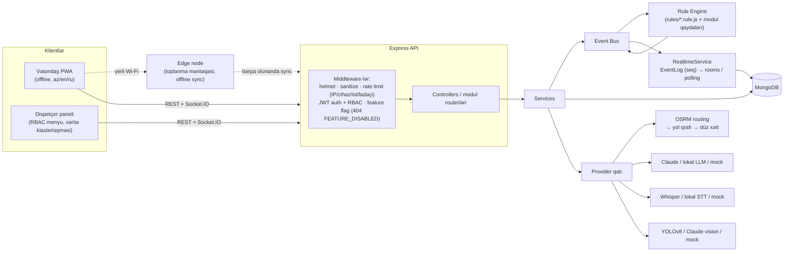

# SafeFlow — Urban Crisis & Crowd Evacuation Engine

SafeFlow zəlzələ, daşqın, sənaye qəzası və kütləvi tədbirlər zamanı istifadə olunan böhran idarəetmə platformasıdır:

- **Vətəndaş** bir toxunuşla SOS göndərir, ona uyğun toplanma məntəqəsini, onun dolulluğunu və təxliyə marşrutunu görür (internet olmasa belə — offline rejim).
- **Böhran mərkəzi (dispetçer)** SOS axınını real vaxtda prioritet növbəsi kimi alır; kritik vəziyyətlər avtomatik **qırmızı alert** yaradır, operator bir kliklə təsdiqləyib briqada(lar) göndərir.
- Üstəlik: məhdud hərəkət imkanlı şəxslər üçün Priority #1 və maneəsiz marşrut, dronlarla təchizat, edge node (offline yerli şəbəkə), partner API, könüllülər, əlçatanlıq (Morse, qısayol SOS) və 5 AI modulu (səsli SOS, dron görüntüsündən zərər analizi, izdiham proqnozu, RAG çatbot, təchizat planı).

```
Core Project/
├── backend/             # Express 5 + MongoDB + Socket.IO (ümumi server)          :5000
├── client-citizen/      # Modul 1 — vətəndaş PWA (mobile-first, offline, az/en/ru)  :5173
├── client-dispatcher/   # Modul 2 — böhran mərkəzi paneli (RBAC, az/en/ru)         :5174
├── edge/                # Edge node (toplanma məntəqəsində yerli server) konfiqurasiyası
└── demo/split.html      # Video çəkiliş üçün yan-yana görünüş (telefon + dispetçer)
```

Konvensiyalar: serverdə `#` subpath alias-ları, klientlərdə `@` alias-ları, hər qovluqda `index.js` barrel, bütün xarici paketlər `lib/` vasitəsilə import olunur.

---

## 1. Tələblər

| Alət | Versiya |
|---|---|
| Node.js | 20+ |
| MongoDB | 7 (lokal, `mongodb://localhost:27017`) |
| npm | Node ilə gələn versiya |

AI açarları **məcburi deyil** — onlar olmadan bütün AI funksiyaları deterministik mock məlumatla işləyir (cavabda `mock: true` işarəsi ilə).

## 2. Lokal işə salma (addım-addım)

**1) Backend** (port 5000):

```bash
cd backend
npm install
cp .env.example .env        # Windows: copy .env.example .env
npm run dev                 # http://localhost:5000
```

İlk açılışda backend simulyasiya olunmuş şəhəri (Bakı koordinatları üzərində sintetik yol şəbəkəsi), sığınacaqları, briqadaları və test hesablarını yaradır.

**2) Vətəndaş tətbiqi** (port 5173):

```bash
cd client-citizen
npm install
npm run dev                 # http://localhost:5173
```

**3) Dispetçer paneli** (port 5174):

```bash
cd client-dispatcher
npm install
npm run dev                 # http://localhost:5174
```

**4) (İstəyə görə) yan-yana demo görünüşü:** `demo/split.html` faylını brauzerdə açın — solda telefon çərçivəsində vətəndaş tətbiqi, sağda dispetçer paneli.

### Test hesabları (`.env.example`-dan, yalnız dev/test üçün)

| Rol | Login | Parol |
|---|---|---|
| admin | `admin` | `Admin123!` |
| dispatcher | `dispatcher` | `Dispatcher123!` |
| brigade_lead | `brigade1` | `Brigade123!` |
| shelter_manager | `manager1` | `Manager123!` |

Vətəndaş tətbiqi hesab tələb etmir — anonim cihaz UUID-si ilə identifikasiya olunur. Real istifadədən əvvəl `.env`-də bütün parolları və `ACCESS_SECRET_KEY`-i dəyişin.

### İstəyə görə AI açarları (`backend/.env`)

| Dəyişən | Nə üçün | Olmadıqda |
|---|---|---|
| `ANTHROPIC_API_KEY` | Claude — SOS mətninin NLP təhlili, RAG çatbot, vision fallback | mock |
| `AI_LOCAL_URL` | Self-hosted LLM gateway (`/v1/structured`, `/v1/chat`) | mock |
| `OPENAI_API_KEY` və ya `STT_API_KEY` / `STT_BASE_URL` | Whisper (API və ya lokal) — səsli SOS üçün speech-to-text | mock |
| `VISION_YOLO_URL` | YOLOv8 zərər modeli serveri (`POST /predict`) | mock |
| `ROUTING_EXTERNAL_URL` | OSRM-uyğun xarici marşrut servisi | simulyasiya olunmuş yol qrafı |

## 3. Testlər

```bash
cd backend
npm run test:unit          # 120 unit test — alqoritm kənar halları (4/3 siqnal, eyni cihaz ×4, 499/501 m, 4:59/5:01, 89/90%, 94/95%, cooldown, modullar, AI)
npm run test:integration   # 125 inteqrasiya testi (7 fayl) — API + WebSocket + MongoDB: RBAC, idempotentlik, klasterləşmə, fallback, 429, replay, modullar
npm run test:load          # Artillery — normal və pik yük
npm run test:stress        # Artillery — sınma nöqtəsinə qədər artım
npm run test:realtime      # 1000+ socket, fan-out və alert yaranma vaxtı
npm run test:integrity     # spam selində real SOS-ların itirilməməsi
npm run test:report        # → tests/load/reports/REPORT.md
npm run lint               # ESLint
```

Son nəticələr: [backend/tests/load/reports/REPORT.md](backend/tests/load/reports/REPORT.md) (bir developer maşınında ölçülüb — API, MongoDB, yük generatoru və Vite serverləri eyni hostda). Əsas rəqəmlər: 1020 eyni vaxtlı socket (0 uğursuz), SOS → dispetçer fan-out p95 **16.6 ms**, alert yaranma vaxtı p95 **28.8 ms**, spam selində 500/500 real SOS qəbul olunub (0 itki, 0 dublikat).

**Gecikmə — dürüst mənzərə:**

| Ölçmə | Nəticə |
|---|---|
| Ayrı prosesdən benchmark, warm-up-dan sonra 40 eyni vaxtlı sorğu | əsas SOS p95 ≈ 150 ms · səsli SOS ≈ 190–250 ms · çatbot ≈ 90–100 ms · proqnoz/təchizat planı (keşli) ≈ 40–55 ms |
| Soyuq başlanğıc (ilk partlayış) | ≈ 300 ms |
| Köhnə Artillery hesabatı | ~100 req/s-ə qədər p95 < 200 ms; tək maşında sınma nöqtəsi ~145 SOS/s (bundan sonra p95 1.5–2 s-ə qalxır və xətalar başlayır) |

---

## 4. Arxitektura



Qısa ASCII versiya:

```
 Vətəndaş PWA ─┐                       ┌──────────── Express API ────────────┐
               ├─ REST + Socket.IO ──► │ helmet → sanitize → rate limit →    │
 Dispetçer ────┘                       │ JWT/RBAC → feature flag → controller│
                                       └──────────────┬──────────────────────┘
 Edge node ── offline sync ───────────────────────────┤
                                                      ▼
                         Services ──► EventBus ──┬──► RuleEngine ──► (yeni hadisələr)
                            │                    └──► Realtime (seq EventLog) ──► rooms / polling
                            ├──► MongoDB
                            └──► Providers: OSRM | Claude/LLM | Whisper/STT | YOLO/Vision (hamısında mock fallback)
```

### Əsas komponentlər

- **`engine/` — təmiz qərar məntiqi** (I/O yoxdur, unit testlərlə örtülüb): sliding-window klasterləşmə (fərqli cihazlar; zona və haversine radiusu ayrıca), cooldown/de-dublikasiya, sığınacağın 90%/95% səviyyələri, triage prioriteti, çəkili sığınacaq balı, dolma vaxtı proqnozu, spam evristikası, RBAC həlli.
- **Runtime konfiqurasiya** — defolt dəyərlər `backend/config/defaults/crisis.json`-da (`features`, `sosCluster`, `shelter`, `sos`, `triage`, `routing`, `brigade`, `events`, `rateLimits` + modul bölmələri), MongoDB-dən override olunur, admin paneldən (`PATCH /api/admin/config`) restart olmadan validasiya ilə dəyişdirilir.
- **RBAC** — `backend/config/rbac.json`: rollar (`citizen`, `volunteer`, `shelter_manager`, `brigade_lead`, `dispatcher`, `admin`), irsiyyət (`inherits`), wildcard (`sos:*`) və hər realtime kanalı üçün tələb olunan icazə. Route-lar yalnız *icazə* ilə qorunur, rol adı ilə yox — həm REST, həm WebSocket-də. Dispetçer menyusu istifadəçinin icazələrindən avtomatik qurulur.
- **SOS bütövlüyü** — hər SOS `clientId` (idempotency açarı) daşıyır; şəbəkə təkrarı ikinci tiket yaratmır. Spam bloklanmır, işarələnir və klaster sayına daxil edilmir; "Mən təhlükəsizəm" SOS-u klaster sayından çıxarır.
- **Marşrut fallback zənciri** — xarici OSRM (qısa timeout + circuit breaker) → simulyasiya yol qrafı (Dijkstra) → düz xətt (`approximate: true`, vətəndaşa "təxmini marşrut" bildirişi).
- **Realtime** — hər hadisə `{seq, type, data, epoch}`; yenidən qoşulanda buraxılmış hadisələr `sync` ilə gəlir; WebSocket yoxdursa `GET /api/events?after=seq` polling.
- **Audit** — hər operator əməliyyatı append-only `AuditLog`-a yazılır.
- **Simulyator** — "Yasamalda zəlzələ" və "Səbaildə sel" ssenariləri real vaxtda SOS axını, sığınacaq axını, yol bağlanmaları və spam partlayışı yaradır. "Reset simulation" bütün modulların əməliyyat məlumatlarını təmizləyir.

### Sorğu axını nümunəsi: SOS → qırmızı alert → briqadalar

```
1. Vətəndaş "SOS" düyməsini basır → POST /api/citizen/sos {clientId, lat, lng, mobility?}
   (offline-dırsa növbəyə yazılır, şəbəkə qayıdanda eyni clientId ilə göndərilir → dublikat yoxdur)
2. Middleware: rate limit (IP + cihaz) → sanitize → validasiya (zod)
3. SosService: idempotent upsert, spam evristikası, triage prioriteti (məhdud hərəkət = Priority #1)
4. EventBus "sos:created" → Realtime → dispetçerə "sos" kanalı (p95 ≈ 17 ms)
5. RuleEngine: sos-cluster qaydası — 5 dəq / 500 m daxilində ≥ 4 fərqli cihaz (spam və "təhlükəsiz" sayılmır)
6. Qırmızı alert yaranır (cooldown ilə) → "alerts" kanalı → dispetçer ekranında qırmızı kart
7. Dispetçer "Təsdiqlə" → brigade suggestion modulu ETA üzrə sıralanmış briqadaları təklif edir
8. Operator bir və ya bir neçə briqada seçir (multi-brigade) → AuditLog → briqadalara "brigades" kanalı
9. Vətəndaş tətbiqində status yenilənir; sığınacaq və marşrut məlumatı real vaxtda gəlir
```

---

## 5. Challenge Drop-lara uyğunlaşma

Hakatonda tələblər mərhələlərlə ("Challenge Drop") gəldi. Hər dəfə əsas arxitekturanı sındırmadan yeni tələbi qəbul etmək üçün aşağıdakı genişlənmə nöqtələri istifadə olundu:

| Mexanizm | Harada | Nə verir |
|---|---|---|
| Feature-modul reyestri | `backend/modules/index.js` | Yeni modul = qovluq + **bir import sətri**; modul öz model/servis/route/qayda/`init`/`reset`/`stop` hook-larını gətirir |
| Feature flag-lar | `crisis.json → features`, `middlewares/feature.js` | Hər modul runtime-da açılıb-bağlanır; bağlı modul `404 FEATURE_DISABLED` qaytarır |
| Config-driven RBAC | `config/rbac.json` | Yeni rol/icazə = JSON-da bir sətir; UI menyusu avtomatik |
| Runtime konfiqurasiya + validasiya | `config/defaults/*.json`, admin panel | Hədlər və çəkilər restart-sız dəyişir; yanlış dəyər validasiyadan keçmir |
| Event bus + rule engine | `services`, `rules/` | Yeni davranış mövcud hadisələrə abunə olan yeni qaydadır, mövcud koda toxunmur |
| Provider qatı + mock fallback | routing, `modules/ai/providers` | Xarici servis yoxdursa/çökərsə növbəti provider; demo həmişə işləyir |
| UI slotları | klientlərdə `modules/`, profil linkləri, root router-lər | Modul öz səhifəsini/kartını əsas layout-u dəyişmədən əlavə edir |

### Drop 0 — Əsas modullar (Modul 1 və Modul 2)
**Tələb:** vətəndaş SOS tətbiqi və böhran mərkəzi paneli. **Həll:** Express + MongoDB + Socket.IO ümumi server, iki ayrı Vite klienti, təmiz `engine/` qatı.

### Drop 1 — Böyük spesifikasiya paketi
**Tələb:** offline rejim, REST/WebSocket replay, idempotent SOS, sliding-window klasterləşmə, RBAC, routing fallback, rate limiting, i18n (az/en/ru), testlər.
**Necə qəbul olundu:** qərar məntiqi `engine/`-də saf funksiyalar kimi yazıldığı üçün kənar halları (499/501 m, 4:59/5:01) unit testlərlə dəqiq yoxlandı; event-lərin `seq` nömrələnməsi replay və polling-i eyni mənbədən verdi; RBAC kodda yox, `rbac.json`-da; marşrut provider zənciri kimi qurulub; hədlər runtime config-də.

### Drop 2 — Dispetçer performansı + xəritə klasterləşməsi
**Tələb:** SOS seli altında dispetçer ekranı donmamalıdır. **Həll:** dashboard-da hadisələrin batch-lə emalı, SOS markerlərinin xəritədə klasterləşdirilməsi, spam/təhlükəsiz cihazların alert sayından çıxarılması. Backend dəyişmədi — dəyişiklik klient tərəfdə qaldı.

### Drop 3 — Məhdud hərəkət imkanlı şəxslər Priority #1 + maneəsiz marşrut
**Tələb:** əlil arabası və s. olan vətəndaşlar növbədə birinci olmalı, marşrut pilləkənsiz olmalıdır. **Həll:** bu drop modul fundamentinin (runtime feature flag-lar, modul reyestri, rollar) yaradılmasına təkan verdi. Triage çəkilərinə mobility faktoru, routing-ə `accessibleRouting` flag-ı ilə maneəli kənarlardan qaçma, `smartBalancing` ilə sığınacaq yükünün balanslaşdırılması əlavə olundu.

### Drop 4 — 7 feature modul
**Tələb:** dronlar, edge node, partner API, əlçatanlıq, smart balancing, briqada təklifi, könüllülər. **Necə qəbul olundu:** hər biri `modules/<ad>/` qovluğunda müstəqil modul kimi (bəziləri paralel git worktree-lərdə) yazıldı və `modules/index.js`-ə bir sətirlə qoşuldu. Hər modulun öz feature flag-ı, config bölməsi, RBAC icazələri və testləri var:
- **drones** — toplanma məntəqələrinə təchizat çatdırılması;
- **edgeNode** — eyni backend `EDGE_MODE`-da toplanma məntəqəsində yerli şəbəkə kimi işləyir, internet qayıdanda mərkəzlə sinxronlaşır;
- **partnerApi** — OAuth2 client credentials, scope-lar, mTLS, webhook-lar, minimal məlumat paylaşımı;
- **accessibility** — qısayol SOS, Morse səs/işıq siqnalı, WCAG 2.1 AA yoxlaması;
- **brigadeSuggestion** — ETA üzrə sıralama, alternativlər, ən tez boşalacaq briqada;
- **volunteers** — peşəkar könüllülər şəbəkəsi (razılıq ilə qeydiyyat).

### Drop 5 — UX düzəlişləri
**Tələb:** custom select/confirm dialoqları, multi-brigade göndərmə, toplanma məntəqələrindən dron sorğuları, admin bölməsinin təmizlənməsi, simulyasiya reset xətası, mobil redizayn. **Həll:** modul kontraktına awaited `reset` hook-u əlavə edildi (hər modul öz məlumatını silir, dispetçer köhnəlmiş insidentləri atır); admin konfiqurasiyası kateqoriyalara bölündü, rollar matrisi oxunaqlı edildi; ümumi `Select`/`Confirm` komponentləri yaradıldı.

### Drop 6 — 5 AI modulu (< 300 ms tələbi ilə)
**Tələb:** səsli SOS + NLP, dron görüntüsündən zərər analizi (CV), izdiham proqnozu, RAG çatbot, təchizat planı; real və mock provider-lər; gecikmə < 300 ms. **Həll:** öncədən qurulmuş provider qatı (LLM: Claude/lokal/mock, STT: Whisper/lokal/mock, Vision: YOLO/Claude/mock). Hər AI modulu ayrıca feature flag (`aiVoiceSos`, `aiDamage`, `aiForecast`, `aiChatbot`, `aiSupply`) ilə `modules/ai/`-də yaşayır. Ağır işlər arxa fon job-ları kimi icra olunur, API dərhal cavab qaytarır; xarici servis yoxdursa/gecikirsə mock fallback `mock: true` ilə işarələnir. Dron zərər analizi defolt olaraq **human-in-the-loop**-dur (`ai.vision.autoApply=false`): AI nəticəsi yalnız təklifdir, dispetçer onu "Xəritəyə tətbiq et" ilə təsdiqləyir (`POST /api/ai/damage/:id/approve`, audit log-a yazılır) və lazım olsa geri qaytarır (revert).

---

## 6. Dizayn prinsipləri

- Yalnız düz rənglər, gradient yoxdur.
- Status heç vaxt yalnız rənglə göstərilmir: ikon + mətn + rəng.
- 3D ikonlar Microsoft Fluent Emoji 3D-dən (MIT lisenziyası).
- İnterfeys az (defolt), en və ru dillərindədir; seçilmiş dil yadda saxlanılır.

## 7. Əlavə sənədlər

- [AI_DECLARATION.md](AI_DECLARATION.md) — Aİ istifadəsi haqqında bəyannamə
- [EVALUATION.md](EVALUATION.md) — qiymətləndirmə
- [docs/Texniki_izah.docx](docs/Texniki_izah.docx) — texniki izah (yanaşma, texnologiyalar, təhlükəsizlik, performans)
- [docs/DEMO_SCRIPT.md](docs/DEMO_SCRIPT.md) — demo video ssenarisi
- [edge/README.md](edge/README.md) — edge node quraşdırılması
- [backend/tests/load/reports/REPORT.md](backend/tests/load/reports/REPORT.md) — yük testi hesabatı
